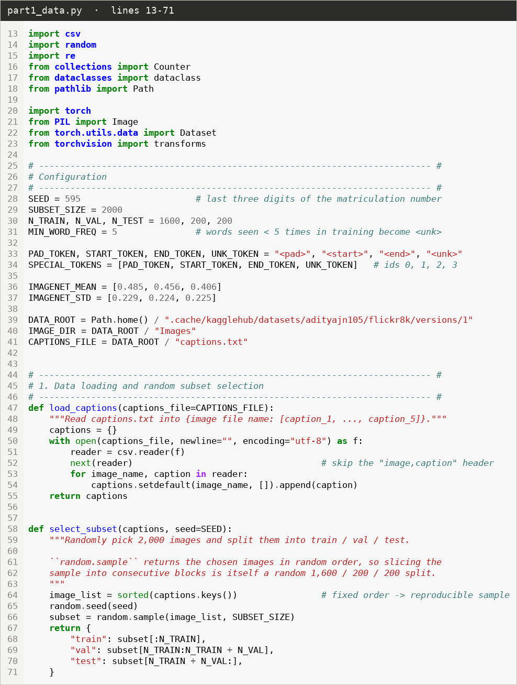
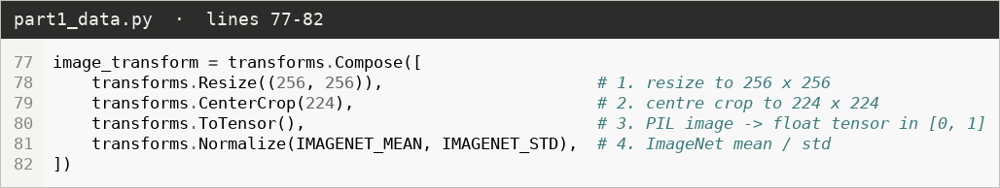
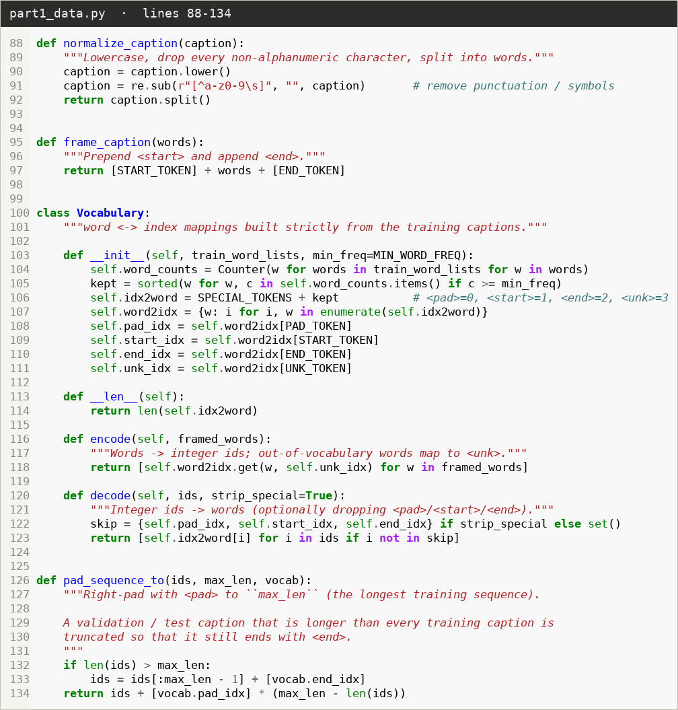
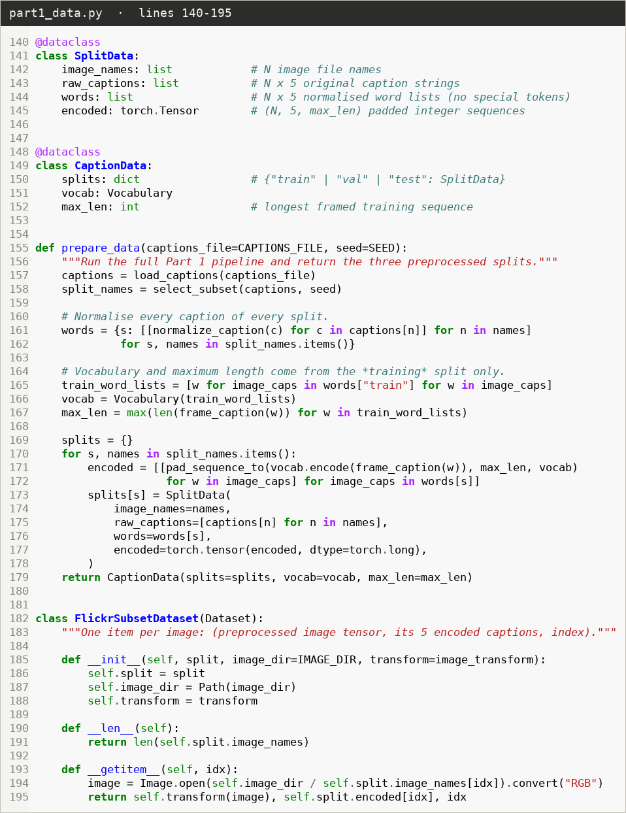
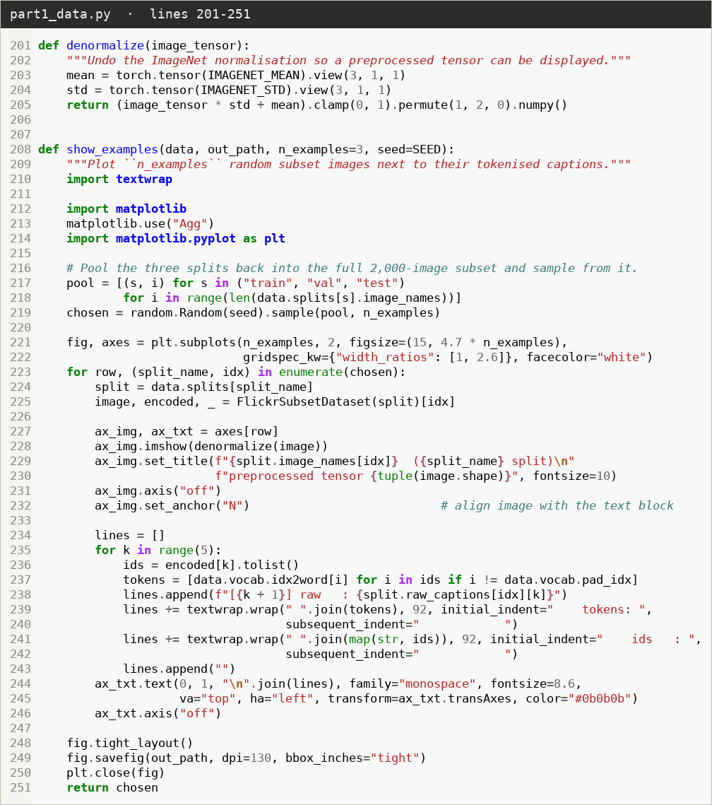
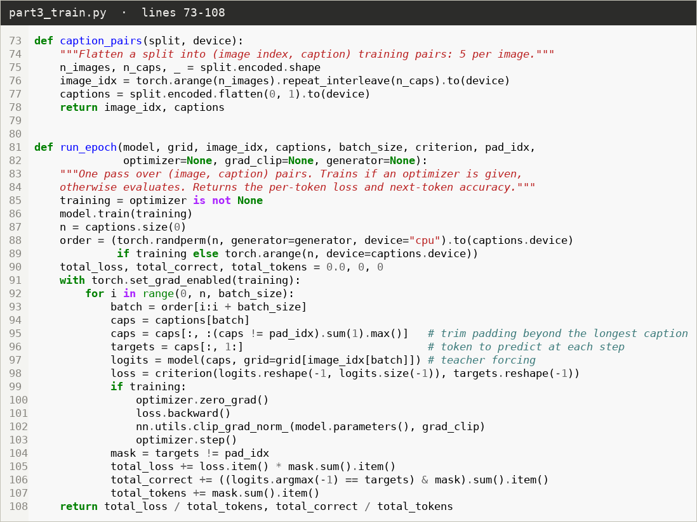
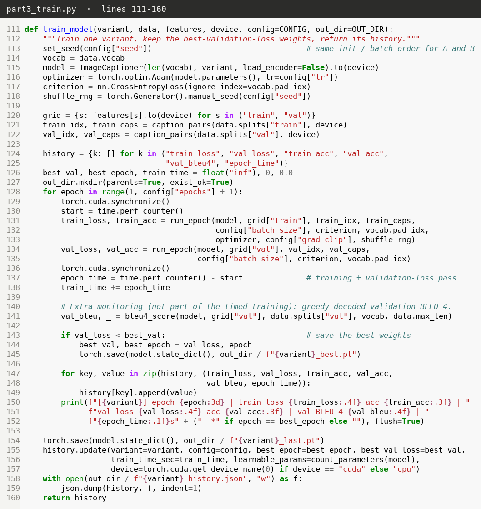
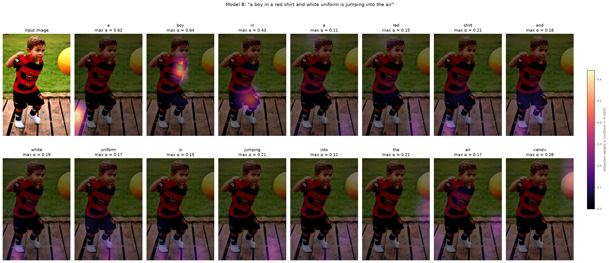
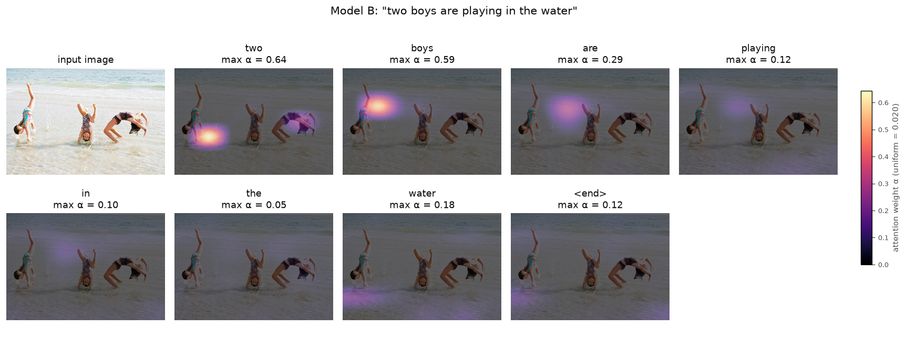

# Project 4: Image Captioning with CNN-RNN Architectures — Global Context vs. Attention

## AI Usage Statement

**AI tool used: Claude Code (Anthropic), running the Claude Fable 5.2 model.**
The tool was used to write the Python code, run the experiments on my GPU, produce the figures and code screenshots, and draft the text of this report. All numbers, tables and figures below come from running the code in this folder with seed 595.

---

## Overview

| Item | Value |
|---|---|
| Dataset | Flickr8k (Kaggle `adityajn105/flickr8k`): 8,091 images, 40,455 captions |
| Subset | 2,000 images (`random.sample`, seed 595) → 1,600 train / 200 validation / 200 test |
| Framework | PyTorch 2.13.0 + torchvision 0.28.0 (CUDA), NLTK 3.10.4 for BLEU |
| Device | NVIDIA GeForce RTX 4080 SUPER (both models trained on it, one after the other) |
| Seed | 595 for subset selection, example selection, weight initialisation, batch shuffling and bootstrap |

**Headline result.** Model B (spatial attention) scored a test BLEU-4 of **0.161** against **0.156** for Model A (global context), but this gap is far inside the noise of a 200-image test set. Model A reached a lower validation loss (2.880 vs. 2.963), trained in half the time (111 s vs. 223 s) and has 12 % fewer learnable parameters. Model B's attention maps nevertheless lock onto the right objects for nouns such as *dog* and *boy*.

**Files**

| File | Purpose |
|---|---|
| `dataset_acquisition.py` | Downloads Flickr8k with `kagglehub` |
| `part1_data.py` | Subset selection, image transform, text pipeline, dataset class, example display |
| `part2_models.py` | ResNet-50 encoder, the two LSTM decoders, the main `ImageCaptioner` class |
| `part3_train.py` | Feature extraction, training loop, best-weight checkpointing |
| `part3_evaluate.py` | BLEU-4, loss curves, qualitative examples, attention heat-maps |
| `make_code_screenshots.py` | Renders the code screenshots in this report directly from the source files |

The code screenshots below carry the file name and line numbers of the code they show.

---

# Part 1: Data Loading and Preprocessing

## 1.1 Dataset acquisition and random subset selection

The dataset was downloaded from Kaggle with `kagglehub.dataset_download("adityajn105/flickr8k")`. It contains an `Images/` folder (8,091 JPEGs) and `captions.txt`, in which every image has exactly 5 captions.

`load_captions` reads the file into a dictionary `{image name: [5 captions]}`. `select_subset` sorts the image names (so the result does not depend on file order), seeds Python's RNG with **595**, and calls `random.sample(image_list, 2000)`. Because `random.sample` returns the images in random order, the first 1,600 become the training set, the next 200 the validation set and the last 200 the test set. The captions travel with their image, so no image is shared between splits.



## 1.2 Image preprocessing

The transform follows the four required steps, in order, so that the images match the format the ImageNet-trained ResNet-50 expects.



Each image becomes a `(3, 224, 224)` float tensor.

## 1.3 Text normalisation and tokenisation

The caption pipeline performs the four required steps in sequence:

1. **Normalisation** — `normalize_caption` lower-cases the text and removes every character that is not a letter, digit or whitespace, then splits on whitespace.
2. **Framing** — `frame_caption` prepends `<start>` and appends `<end>`.
3. **Vocabulary** — `Vocabulary` counts words over the **training captions only** and keeps those seen at least 5 times. The four special tokens take the first indices: `<pad>` = 0, `<start>` = 1, `<end>` = 2, `<unk>` = 3. `word2idx` and `idx2word` are the two mappings.
4. **Tokenisation and padding** — `Vocabulary.encode` maps each word to its index and any out-of-vocabulary word to `<unk>`; `pad_sequence_to` right-pads with `<pad>` to the length of the longest training sequence.



`prepare_data` ties the steps together and `FlickrSubsetDataset` serves `(image tensor, 5 encoded captions)` per image.



**Resulting statistics**

| Quantity | Value |
|---|---|
| Distinct words in the training captions | 4,079 |
| Words kept (frequency ≥ 5) | 1,222 |
| Vocabulary size including the 4 special tokens | **1,226** |
| Longest training sequence (incl. `<start>`/`<end>`) = padded length | **35** |

| Split | Images | Captions | Encoded tensor | Longest sequence | Words mapped to `<unk>` |
|---|---|---|---|---|---|
| Train | 1,600 | 8,000 | (1600, 5, 35) | 35 | 5.40 % |
| Validation | 200 | 1,000 | (200, 5, 35) | 31 | 6.93 % |
| Test | 200 | 1,000 | (200, 5, 35) | 32 | 7.51 % |

No validation or test caption is longer than 35 tokens, so nothing had to be truncated. The `<unk>` rate is higher on validation and test because their rare words were never counted when the vocabulary was built.

## 1.4 Visual display: 3 random subset images with their preprocessed captions

Three images were drawn from the 2,000-image subset with seed 595. Each is shown after the image transform (de-normalised only for display), next to its five captions in raw form, as tokens, and as padded integer sequences of length 35.


The code that produced the display:



---

# Part 2: Architectural Implementation

## 2.1 Freeze or fine-tune the ResNet-50 encoder? (Deliverable 1)

**I froze the ResNet-50 encoder**, for both Model A and Model B. Its weights have `requires_grad = False` and the module is locked in eval mode so the BatchNorm statistics stay at their ImageNet values. The reasons:

- **Overfitting risk.** The training set has only 1,600 images. The encoder has 23.5 M parameters, about five times the decoder (4.3–4.9 M). Fine-tuning it on so few images would mostly memorise them.
- **Fair comparison.** With a frozen encoder both models receive exactly the same visual features. Any difference in the results can only come from how the decoder forms its context vector, which is the point of the ablation.
- **Efficiency.** A frozen encoder with a deterministic transform gives the same output for an image every time. I therefore run the encoder once over the 2,000 images (about 5 s) and reuse the features in all 80 epochs of both models. This is numerically identical to calling the encoder inside every training step.

## 2.2 Feature extraction pipeline (Deliverable 2)

`EncoderCNN` wraps the ImageNet-pretrained ResNet-50 (`IMAGENET1K_V1` weights) without its classification layer. Its forward pass returns both required outputs: the spatial grid taken directly after stage 4, and the global-average-pooled vector **v**.


`extract_features` applies the Part 1 transform through a `DataLoader`, runs the frozen encoder, and caches the grid for each split. Only the grid is stored, because **v** is just its spatial mean and the decoder recomputes it.


Shapes confirmed by running the code:

| Output | Shape |
|---|---|
| Spatial grid after stage 4 | (Batch, 2048, 7, 7) |
| GAP output **v** | (Batch, 2048) |
| Cached training / validation / test grids | (1600, 2048, 7, 7) / (200, 2048, 7, 7) / (200, 2048, 7, 7) |

## 2.3 The two modular decoders (Deliverable 3)

Both decoders inherit from one base class that holds everything they have in common, so they differ only in the `context()` method.

**Shared components (`DecoderBase`)**

- `nn.Embedding(1226, 256)` — embedding dimension 256.
- `nn.LSTMCell(256 + 2048, 256)` — a single-layer LSTM unrolled one step at a time, hidden size 256. Its input is the concatenation of the embedded token and the 2048-d context vector.
- `init_h`, `init_c` — two linear layers that initialise the LSTM state from **v**, so Model B has a meaningful $h_0$ to attend with at the first step.
- `nn.Linear(256, 1226)` — the fully connected classification head.
- Dropout of 0.5 on the embeddings and before the FC layer.


**Model A — `GlobalContextDecoder`.** The context is the static vector **v** at every time step.

**Model B — `AttentionDecoder`.** A dynamic context $u_t$ is computed at every step by scaled dot-product attention between the previous hidden state $h_{t-1}$ (query) and the 49 spatial feature vectors $a_i$ (keys and values):

$$e_{t,i} = \frac{(W_q h_{t-1})^\top (W_k a_i)}{\sqrt{d}}, \qquad \alpha_t = \mathrm{softmax}(e_t), \qquad u_t = \sum_{i=1}^{49} \alpha_{t,i}\, a_i$$

with $d = 256$. $W_q$ (256 → 256) and $W_k$ (2048 → 256) are the only parameters Model B adds.


This design makes the ablation clean. If the attention weights are uniform, $u_t$ is the mean of the 49 regions, which is exactly **v**. Model A is therefore the special case of Model B that ignores the query. I checked this numerically: setting $W_q = 0$ in Model B reproduces Model A's logits to within $2 \times 10^{-7}$, and with the same seed all shared layers of the two models start from identical weights.

**Learnable parameters**

| Component | Model A | Model B |
|---|---|---|
| Embedding (1226 × 256) | 313,856 | 313,856 |
| LSTM cell (2304 → 256) | 2,623,488 | 2,623,488 |
| State initialisation (`init_h`, `init_c`) | 1,049,088 | 1,049,088 |
| FC head (256 → 1226) | 315,082 | 315,082 |
| Attention projections $W_q$, $W_k$ | — | 589,824 |
| **Total learnable** | **4,301,514** | **4,891,338** |
| Frozen ResNet-50 encoder (not learnable) | 23,508,032 | 23,508,032 |

## 2.4 Teacher forcing and autoregressive generation (Deliverable 4)

**Training — teacher forcing.** In `DecoderBase.forward`, the input at step *t* is `captions[:, t]`, the ground-truth token, never the model's own prediction. The output of that step is scored against `captions[:, t+1]`.


The training loop shows the same shift from the other side: the whole caption goes in as input and `targets = caps[:, 1:]` is what the loss compares against. `<pad>` positions are ignored by the loss.



**Inference — greedy autoregressive search.** In `DecoderBase.generate`, decoding starts from `<start>`. At each step the highest-probability word is selected with `argmax` and fed back as the next input. A caption stops when it produces `<end>`; the loop also stops at the maximum training length (35) as a safety limit.


As a consistency check, feeding a greedy caption back through the teacher-forcing path reproduces the same argmax tokens, so the two code paths agree.

## 2.5 Main model class and variant swapping (Deliverable 5)

`ImageCaptioner` takes a `variant` argument. `"global"` builds Model A and `"attention"` builds Model B through the `DECODERS` dictionary; the encoder and the training and inference interfaces are the same for both. The class accepts either raw images or a pre-computed feature grid.


---

# Part 3: Ablation Study and Comparative Analysis

## Training setup

Both variants were trained with identical settings on the same GPU, one after the other.

| Setting | Value (same for Model A and Model B) |
|---|---|
| Epochs | 80 |
| Batch size | 64 (image, caption) pairs; 8,000 pairs per epoch |
| Optimiser | Adam, learning rate 3 × 10⁻⁴, no schedule, no weight decay |
| Loss | Cross-entropy per token, `<pad>` ignored |
| Regularisation | Dropout 0.5, gradient-norm clipping at 5.0 |
| Seed | 595 (same initial weights for shared layers, same batch order) |
| Model selection | Validation loss after every epoch; weights with the lowest value are saved |

The learning rate was chosen from a 40-epoch pilot over {1 × 10⁻³, 3 × 10⁻⁴, 1 × 10⁻⁴} using validation loss only (logs in `outputs/pilot/`). At 1 × 10⁻⁴ both models were still improving at epoch 40; at 1 × 10⁻³ Model B peaked as early as epoch 15. 3 × 10⁻⁴ lets both models reach their minimum well inside the 80-epoch budget. The test set was not used for any choice.

`train_model` runs the loop, records the curves and saves the best weights.



## A. Empirical Results

### A.1 Loss curves


*Solid lines are training loss, dashed lines validation loss. The dots mark the epoch whose weights were saved.*

Token accuracy under teacher forcing and greedy-decoded validation BLEU-4 were also logged every epoch:


### A.2 Performance metrics

| Metric | Model A (global context) | Model B (spatial attention) |
|---|---|---|
| **Corpus BLEU-4, test set (200 images)** | **0.1560** | **0.1607** |
| 95 % bootstrap interval of BLEU-4 | 0.133 – 0.178 | 0.131 – 0.188 |
| **Total training time (80 epochs)** | **111.3 s** | **222.8 s** |
| **Learnable parameters** | **4,301,514** | **4,891,338** |
| Best epoch (lowest validation loss) | 49 | 35 |
| Best validation loss | 2.880 | 2.963 |
| Test BLEU-1 / BLEU-2 / BLEU-3 | 0.574 / 0.389 / 0.251 | 0.554 / 0.374 / 0.246 |

Notes on how these were measured:

- **BLEU-4** is computed on the saved best-validation-loss weights with greedy decoding, against all five references per image.
- **Training time** is the wall-clock time of the 80 training passes plus the 80 validation-loss passes. It excludes the one-off feature extraction (about 5 s, shared by both models), the BLEU monitoring and checkpoint writing. Per-epoch times fluctuated (0.95–2.2 s for A, 1.7–4.7 s for B) because the GPU also drives the desktop; the ratio of median epoch times is 1.9×.
- **Bootstrap.** Resampling the 200 test images 1,000 times gives a 95 % interval for the difference B − A of **−0.024 to +0.030**; Model B was ahead in 61 % of the resamples. The BLEU-4 difference is not statistically meaningful.

### A.3 Qualitative examples and attention heat-maps

Three test images were drawn at random with seed 595.


For Model B, each panel below shows the attention weights $\alpha_t$ used to predict that word. The 7 × 7 map is up-sampled and laid over the part of the original image the network sees (the central 87.5 %, which is what Resize + CenterCrop keeps). All panels in a figure share one colour scale, so a dark panel means the attention was spread out for that word.

**Example 1 — "a dog is jumping over a tree"**


The map for *dog* puts 84 % of its weight on a single cell on the dog's body. For *over*, *a* and *tree* the attention moves to the lower right, along the log, but is much more diffuse.

**Example 2 — "a boy in a red shirt and white uniform is jumping into the air"**



*boy* is attended on the child's face and shoulder (0.64) and *in* on his shorts (0.43). From *a red shirt* onwards the attention is weak and sits on the wooden floor, not on the shirt. At the `<end>` step it moves to the yellow ball, which the caption never mentions.

**Example 3 — "two boys are playing in the water"**



*two* and *boys* focus on the children on the left (0.64 and 0.59), and *water* shifts to the water at the bottom of the frame. The caption itself is wrong about the count and gender.

### A.4 Code for BLEU-4 and the attention visualisation

**Corpus-level BLEU-4.** `generate_captions` greedy-decodes each image and cuts the output at the first `<end>`. `bleu4_score` passes the hypotheses and the five references per image to NLTK's `corpus_bleu` with weights (0.25, 0.25, 0.25, 0.25). The references are the normalised human captions, not mapped to `<unk>`, so a generated `<unk>` can never count as a match.


**Attention visualisation.**


## B. Comparative Analysis

### B.1 Architectural influence

**Validation loss progression.** Replacing the fixed vector **v** with a dynamic context helped early and hurt later.

- In each of the first 18 epochs Model B had the lower validation loss (epoch 5: 3.559 vs. 3.621; epoch 10: 3.242 vs. 3.282). Being able to re-weight the 49 regions gave it a head start.
- The curves cross at epoch 19. From then on Model A keeps improving until epoch 49 and reaches **2.880**, while Model B bottoms out at epoch 35 at **2.963**. In perplexity terms that is about 17.8 against 19.4.
- After its minimum, Model B's validation loss climbs back to 3.109 by epoch 80 (+0.146). Model A's rises only to 2.912 (+0.032).

So on this data the attention mechanism made the model fit the training captions faster but generalise slightly worse as measured by loss.

**Descriptive accuracy of the generated text.** The picture from the captions is mixed, and the differences are small.

- **BLEU-4** is marginally higher for Model B (0.1607 vs. 0.1560), but the bootstrap interval of the difference (−0.024 to +0.030) comfortably includes zero.
- **BLEU-1 to BLEU-3** are all slightly higher for Model A (BLEU-1: 0.574 vs. 0.554). Model A gets more individual words right; Model B gets slightly more four-word runs right.
- **`<unk>` output.** Model B emitted `<unk>` 175 times across the 200 captions (8.8 % of its tokens) against 113 for Model A (5.8 %). A generated `<unk>` never matches a reference, which accounts for part of Model B's lower BLEU-1.
- **Diversity.** Both models produced 187 distinct captions for the 200 images and copied very few verbatim from the training set (6 for A, 3 for B). Model A used 145 distinct words, Model B 124, out of a vocabulary of 1,226. Only 8 of the 200 images received the same caption from both models.

The three qualitative examples show what the numbers cannot:

- **Dog.** Model A falls back on a very common training pattern, "a dog runs through the grass". Model B produces "a dog is jumping over a tree", which matches the references ("leaping over a fallen tree"), and its attention for *dog* sits on the dog.
- **Boy.** Model A loops: "a boy in a red shirt and a red shirt and a ball in a ball". It does mention the ball. Model B is fluent but invents "white uniform" and "jumping into the air" and misses the ball.
- **Girls on the beach.** Model A is vague but not wrong ("a group of people are playing in the sand"). Model B is more specific and wrong ("two boys" for three girls).

Repetition is a failure of both models, not of one: 22 of Model A's captions and 17 of Model B's contain a repeated three-word phrase.

**Why this happened.** Two things in the results point to the explanation.

1. Model B contains Model A as a special case, and the only extra freedom is the non-uniform weighting. The attention statistics show that it used this freedom: on the test set the average attention map has an entropy of 2.57 nats against 3.89 for a uniform map, equivalent to concentrating on about 16 of the 49 regions, and the mean peak weight is 0.27 (uniform would be 0.02).
2. That extra freedom was spent partly on fitting the training set. By epoch 80 Model B's training loss is 1.83 against 2.06 for Model A, yet its validation loss is higher. A context built from a handful of individual grid cells varies more from image to image than the average of all 49, and with only 1,600 training images the decoder had enough capacity to memorise those variations.

### B.2 Learning dynamics

**Convergence speed.** Model B converged faster in every sense except the final value. Its training loss is below Model A's from the first epoch and the gap widens steadily. It reached its best validation loss at epoch 35 against epoch 49 for Model A, and came within 0.02 of that best by epoch 30 against epoch 35. In wall-clock terms the advantage disappears, because a Model B epoch takes about twice as long.

**Smoothness.** Both loss curves are smooth; there are no spikes or instabilities in either training run. After epoch 20 the epoch-to-epoch change in validation loss has a standard deviation of 0.006 for Model A and 0.009 for Model B, so Model B is slightly rougher. Validation BLEU-4 is a different matter: it jumps by ±0.01 to 0.02 from one epoch to the next for both models (standard deviation 0.010 for A and 0.008 for B over epochs 31–80). This is a reminder that BLEU on 200 images is a noisy measure, and it is why the 0.005 test difference should not be read as a win for attention.

**Overfitting and underfitting.**

- Neither model is underfitting at its selected checkpoint; both are well past the point where training loss drops below validation loss (epoch 15 for A, epoch 12 for B).
- Both models overfit, and Model B overfits earlier and harder.

| | Model A | Model B |
|---|---|---|
| Train – validation loss gap at best epoch | 0.52 | 0.55 |
| Train – validation loss gap at epoch 80 | 0.86 | 1.28 |
| Rise in validation loss from its minimum to epoch 80 | +0.032 | +0.146 |
| Training token accuracy at epoch 80 | 48.1 % | 52.5 % |
| Validation token accuracy at epoch 80 | 37.1 % | 35.2 % |

- The accuracy curves tell the same story. Model A's validation accuracy is still creeping upwards late in training (peak 37.2 % at epoch 64). Model B's peaked at 35.9 % at epoch 38 and then drifted down while its training accuracy kept climbing.
- Saving the best-validation-loss weights mattered. The epoch-80 weights score a lower test BLEU-4 for both models: 0.139 instead of 0.156 for Model A and 0.151 instead of 0.161 for Model B.

**Loss and BLEU do not move together.** After about epoch 30, validation BLEU-4 of both models fluctuates around 0.145 without a clear trend, even while Model B's validation loss rises. A plausible reading is that the rising loss mostly reflects over-confident next-word probabilities, while the greedy caption, which depends only on which word is ranked first, changes much less. I did not measure this directly.

### B.3 Overall synthesis

For this task — a frozen ResNet-50, 1,600 training images and 80 epochs — the choices that controlled overfitting were the ones that paid off, and added capacity did not.

- **The global-context baseline was the more effective choice on the measured criteria.** Model A reached the lower validation loss (2.880 vs. 2.963), trained in half the time (111 s vs. 223 s), has 590 k fewer parameters, and its test BLEU-4 (0.156) is statistically indistinguishable from Model B's (0.161). The GAP vector is the representation ResNet-50 was itself trained to classify from, and it turned out to be a stable enough summary for captions of this length.
- **Attention learned something real, but it did not translate into measurably better captions.** The heat-maps show sensible grounding for object words, learned from caption supervision alone. Averaged over the test set, the attention used to predict *man* and *dog* is the sharpest of all frequent words, and function words are the most diffuse:

| Word predicted | Mean peak weight | Effective regions (of 49) |
|---|---|---|
| man | 0.45 | 8.2 |
| dog | 0.44 | 10.3 |
| a | 0.29 | 14.2 |
| is | 0.22 | 18.2 |
| on | 0.21 | 18.7 |
| the | 0.17 | 20.3 |
| through | 0.16 | 21.0 |

  The same maps also show the limits. Attribute words such as *red* and *shirt* were not grounded on the shirt in example 2, and in example 3 sharp attention on the children still produced the wrong count and gender. Localising the right region is not the same as describing it correctly.
- **Freezing the encoder and selecting by validation loss were both worthwhile.** Freezing kept the comparison fair and the whole study to under six minutes of training. Checkpoint selection improved test BLEU-4 over the final-epoch weights for both models.

**Limitations.** These conclusions rest on one training run per model with seed 595 and a 200-image test set. The bootstrap covers test-set sampling noise but not run-to-run variation, so the ranking on BLEU-4 could flip with another seed. The ranking on validation loss was the same in my pilot run at learning rate 1 × 10⁻³ (2.880 for A vs. 2.946 for B), which gives it somewhat more support. I would expect attention to benefit from more training data or stronger regularisation of its context path, but I did not test that here.

---

## Reproducing the results

```bash
python dataset_acquisition.py     # download Flickr8k
python part1_data.py              # Part 1 statistics and example display
python part2_models.py            # shape and parameter-count check
python part3_train.py             # extract features, train Model A then Model B
python part3_evaluate.py          # BLEU-4, curves, qualitative figures, attention maps
python make_code_screenshots.py   # code images used in this report
```

Outputs are written to `outputs/` (`part1/`, `part3/`, `code/`); the full per-epoch log is `outputs/part3/train.log` and all reported numbers are in `outputs/part3/metrics.json`.
